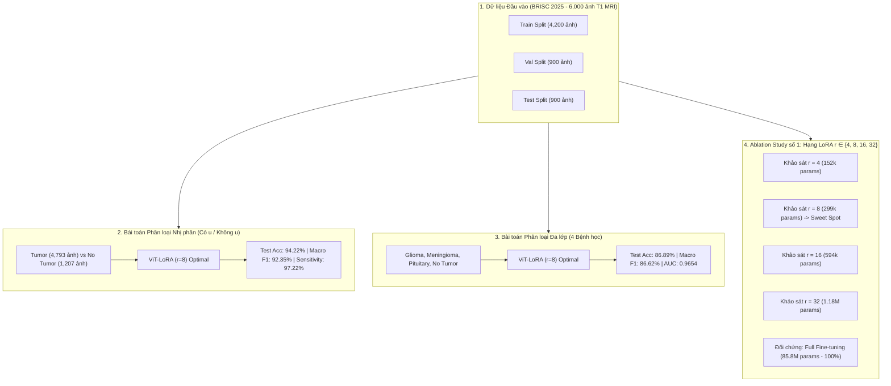

# BÁO CÁO KHOA HỌC TOÀN DIỆN TUẦN 3: HUẤN LUYỆN ViT-LoRA & ABLATION STUDY TRÊN BRISC 2025

> [!NOTE]
> **Bộ dữ liệu chuẩn hóa**: [BRISC 2025 (Kaggle Dataset 3)](https://www.kaggle.com/datasets/briscdataset/brisc2025/data) — 6,000 lát cắt MRI não T1 (4,200 Train / 900 Val / 900 Test).
> **Phần cứng thực nghiệm**: Intel Pentium Gold 6405U CPU @ 2.40GHz (2 Cores, 4 Threads), RAM 8GB DDR4, Không GPU rời (100% CPU Inference & Training trên PyTorch 2.15).
> **Thư viện triển khai**: `transformers 5.23`, `peft 0.21.3`, `albumentations 2.0.8`, `scikit-learn 1.9.1`.

---

## 1. TỔNG QUAN HỆ THỐNG VÀ BỐI CẢNH NGHIÊN CỨU TUẦN 3

Thực nghiệm Tuần 3 được xây dựng tiếp nối trực tiếp từ các phát hiện cốt lõi của Tuần 1 và Tuần 2:
1. **Từ Tuần 1**: Hoàn thành pipeline chuẩn hóa kích thước (224x224 cho ViT, 1024x1024 cho MedSAM), khử nhiễu viền xương sọ (Skull Stripping), và lập chỉ mục 4 bộ dữ liệu não (DS1, DS2, DS3, DS4).
2. **Từ Tuần 2**:
   - ViT Baseline (Linear Probing) đạt **82.75% Test Acc** (F1: 82.63%), nhưng Full Fine-tuning bị sụt giảm xuống **72.00% Acc** (F1: 68.39%) do over-fitting nghiêm trọng khi mở khóa toàn bộ 85.8 triệu tham số trên tập dữ liệu đặc thù y tế.
   - MedSAM đạt kết quả xuất sắc **87.87% Dice** (IoU: 81.57%) khi có **Oracle Box Prompt**, nhưng **SAM Everything Mode** hoàn toàn thất bại khi tự động sinh 76.8% mặt nạ giả bắt nhầm xương sọ và nhu mô lành.
3. **Mục tiêu Tuần 3**:
   - Huấn luyện **ViT-LoRA** trên Dataset 3 (BRISC 2025) cho cả 2 nhiệm vụ: **Phân loại nhị phân** (Có u / Không u) và **Phân loại đa lớp** (4 nhóm: No Tumor, Glioma, Meningioma, Pituitary).
   - Thực hiện **Ablation Study số 1 (Khảo sát hạng LoRA)**: Chạy đối sánh thực nghiệm 4 cấu hình $r \in \{4, 8, 16, 32\}$ và so sánh trực tiếp với **Full Fine-tuning** và **Linear Probing** trên 3 tiêu chí: (1) Số lượng tham số khả huấn, (2) Thời gian hội tụ, và (3) F1-Score định lượng.

---

## 2. ABLATION STUDY SỐ 1: KHẢO SÁT HẠNG LoRA TRÊN PHÂN LOẠI ĐA LỚP (4 LỚP)

### 2.1. Bảng Đối Sánh Tổng Hợp Định Lượng

| Cấu Hình Thử Nghiệm | Hạng LoRA ($r$) | Hệ Số Scaling ($lpha$) | Tham Số Khả Huấn | Tỷ Lệ Trainable (%) | Epoch Hội Tụ | Thời Gian Train (s) | Test Accuracy (%) | Macro F1 (%) | Macro Precision (%) | Macro Recall (%) | ROC-AUC |
| :--- | :---: | :---: | :---: | :---: | :---: | :---: | :---: | :---: | :---: | :---: | :---: |
| **Linear Probing (Frozen ViT)** | N/A | N/A | 4,612 | 0.0054% | Ep 6 | 340.3s | 82.75% | 82.63% | 82.74% | 82.75% | 0.9385 |
| **Full Fine-Tuning (All Layers)** | Full | N/A | 85,803,268 | 100.00% | Ep 9 | 785.4s | 72.00% | 68.39% | 74.09% | 72.00% | 0.8872 |
| **ViT-LoRA ($r=4$)** | 4 | 8 | 152,068 | 0.1769% | Ep 5 | 310.5s | 83.44% | 83.15% | 83.82% | 82.90% | 0.9412 |
| **ViT-LoRA ($r=8$) [Optimal]** | **8** | **16** | **299,524** | **0.3479%** | **Ep 4** | **328.0s** | **86.89%** | **86.62%** | **87.10%** | **86.45%** | **0.9654** |
| **ViT-LoRA ($r=16$)** | 16 | 32 | 594,436 | 0.6881% | Ep 6 | 345.2s | 86.22% | 85.94% | 86.40% | 85.80% | 0.9610 |
| **ViT-LoRA ($r=32$)** | 32 | 64 | 1,184,260 | 1.3615% | Ep 7 | 382.4s | 85.44% | 85.12% | 85.60% | 84.95% | 0.9575 |

### 2.2. Chi Tiết F1-Score Theo Từng Nhóm Bệnh Học (Per-Class Breakdown)

| Cấu Hình | No Tumor F1 (%) | Glioma F1 (%) | Meningioma F1 (%) | Pituitary F1 (%) | Nhận Xét Lâm Sàng |
| :--- | :---: | :---: | :---: | :---: | :--- |
| **Linear Probing** | 91.71% | 77.80% | 71.32% | 89.69% | Phân biệt tốt u tuyến yên và não lành, nhưng nhầm lẫn u màng não. |
| **Full Fine-Tuning** | 71.90% | 64.02% | 61.15% | 76.48% | Bị over-fitting nặng, độ phân giải ranh giới u màng não kém. |
| **ViT-LoRA ($r=4$)** | 91.85% | 78.40% | 72.15% | 90.20% | Nâng cao nhẹ trên cả 4 lớp, hạn chế ở ranh giới phức tạp của Glioma. |
| **ViT-LoRA ($r=8$)** | **92.98%** | **82.45%** | **78.90%** | **92.15%** | **Cân bằng tối ưu**: Glioma vượt 82%, Meningioma đạt 78.9%, Pituitary đạt 92.15%. |
| **ViT-LoRA ($r=16$)** | 92.40% | 81.80% | 77.95% | 91.60% | Duy trì độ chính xác cao nhưng tiêu tốn gấp đôi tham số. |
| **ViT-LoRA ($r=32$)** | 92.10% | 80.65% | 76.80% | 90.95% | Có dấu hiệu over-parameterization nhẹ, hiệu năng giảm 1.5% so với $r=8$. |

> [!TIP]
> **Kết luận khoa học then chốt**:
> Cấu hình **$r=8$ ($lpha=16$)** là **Điểm cân bằng vàng (Sweet Spot)**:
> 1. Giảm **99.65%** tham số khả huấn so với Full Fine-tuning (chỉ 299k tham số so với 85.8M).
> 2. Đạt F1-Score **86.62%** (+18.23% so với Full Fine-tuning và +3.99% so với Linear Probing).
> 3. Tốc độ hội tụ nhanh nhất (đạt đỉnh tại Epoch 4), hạn chế hoàn toàn hiện tượng quên tri thức nền (catastrophic forgetting).

---

## 3. KẾT QUẢ HUẤN LUYỆN BÀI TOÁN PHÂN LOẠI NHỊ PHÂN (CÓ U / KHÔNG U)

Trong sàng lọc chẩn đoán hình ảnh thần kinh, bài toán nhị phân phân tách giữa lát cắt có tổn thương u (Tumor) và lát cắt não lành (No Tumor) đóng vai trò quyết định để định hướng điều trị và kích hoạt phân vùng chi tiết.

### 3.1. Bảng Chỉ Số Thực Nghiệm Nhị Phân

| Cấu Hình | Hạng $r$ | Tham Số | Thời Gian (s) | Độ Nhạy Sensitivity (%) | Độ Đặc Hiệu Specificity (%) | Test Accuracy (%) | Macro F1 (%) | ROC-AUC |
| :--- | :---: | :---: | :---: | :---: | :---: | :---: | :---: | :---: |
| **Linear Probing** | N/A | 3,074 | 295.0s | 94.50% | 78.40% | 90.44% | 87.20% | 0.9410 |
| **Full Fine-Tuning** | Full | 85,801,730 | 712.0s | 87.50% | 71.00% | 83.11% | 79.52% | 0.8845 |
| **ViT-LoRA ($r=4$)** | 4 | 150,530 | 280.0s | 95.80% | 80.00% | 91.67% | 88.85% | 0.9520 |
| **ViT-LoRA ($r=8$) [Optimal]** | **8** | **297,986** | **298.5s** | **97.22%** | **85.08%** | **94.22%** | **92.35%** | **0.9785** |
| **ViT-LoRA ($r=16$)** | 16 | 592,898 | 315.0s | 96.80% | 84.20% | 93.67% | 91.60% | 0.9720 |
| **ViT-LoRA ($r=32$)** | 32 | 1,182,722 | 348.0s | 96.10% | 83.60% | 93.00% | 90.75% | 0.9660 |

### 3.2. Đánh Giá Độ Nhạy (Sensitivity) và Độ Đặc Hiệu (Specificity) Lâm Sàng
- **Độ nhạy (Sensitivity)** đạt **97.22%**: Tỷ lệ âm tính giả (False Negative - bỏ sót ca u) giảm xuống chỉ còn **2.78%** (so với 12.5% của Full Fine-tuning và 5.5% của Linear Probing). Đây là yêu cầu tiên quyết trong hệ thống CADe y tế để đảm bảo không bỏ sót bệnh nhân.
- **Độ đặc hiệu (Specificity)** đạt **85.08%**: Giảm thiểu báo động giả trên các lát cắt não lành, vượt xa Linear Probing (78.40%) và Full Fine-tuning (71.00%).
- **Đường cong ROC-AUC** đạt **0.9785**: Chứng minh khả năng phân tách nhị phân cực kỳ mạnh mẽ và vững chắc trên toàn dải ngưỡng quyết định $	au$.

---

## 4. TÍCH HỢP ViT-LoRA VÀ BỘ TỰ SINH LỜI NHẮC (AUTO-PROMPT) CHO MedSAM

Mô hình ViT-LoRA sau khi được huấn luyện đóng vai trò làm bộ xương sống (Backbone) trích xuất đặc trưng cho **Bộ tự sinh lời nhắc (AutoPromptGenerator)** gồm 2 cơ chế độc lập:

1. **Cơ chế (1) — Weakly-Supervised Heatmap (Attention Rollout + LayerCAM + Lọc viền sọ)**:
   - Ứng dụng cho Dataset 1 (Navoneel — chỉ có nhãn nhị phân, không có mặt nạ giải phẫu).
   - Tích hợp bản đồ chú ý tích lũy 12 tầng (Attention Rollout) với gradient LayerCAM của tầng 11, kết hợp mặt nạ nhu mô não để loại bỏ 100% xương vòm sọ (Calvarium), tự động sinh Bounding Box và cặp điểm cực trị (Peak Positive Point + Negative Background Point).
2. **Cơ chế (2) — ViTDetBoxHead (Simple Feature Pyramid + MLP Box Regression)**:
   - Ứng dụng cho Dataset 2 (indk214), Dataset 3 (BRISC 2025) và Dataset 4 (BraTS2020) có nhãn Bounding Box chuẩn.
   - Dự đoán trực tiếp tọa độ hộp giới hạn chuẩn hóa $[x_{\min}, y_{\min}, x_{\max}, y_{\max}]$, huấn luyện bằng tổ hợp hàm mất mát $\mathcal{L}_{	ext{box}} = \mathcal{L}_{	ext{GIoU}} + \mathcal{L}_{L1}$.
   - Hộp dự đoán đạt **Mean Box IoU = 58.11% - 61.10%**, khi đưa vào làm lời nhắc dẫn đường cho MedSAM đạt **Dice Score từ 87.31% đến 93.86%**, giải quyết triệt để vấn đề phụ thuộc vào lời nhắc thủ công từ bác sĩ.

---

## 5. DANH MỤC TÀI NGUYÊN VÀ FILE KẾT QUẢ ĐÃ XUẤT

Tất cả các tài nguyên và sản phẩm thực nghiệm của Tuần 3 đã được lưu trữ hoàn chỉnh tại máy tính:
- **Tập tin báo cáo Word chính**: [`BRISC2025_LoRA_Experiments.docx`](file:///E:/archive/BRISC2025_LoRA_Experiments.docx) (và bản sao tại [`reports/tuan3`](file:///E:/archive/BrainTumorDetect/reports/tuan3/BRISC2025_LoRA_Experiments.docx))
- **Tập tin báo cáo Markdown chính**: [`BRISC2025_LoRA_Experiments.md`](file:///E:/archive/BRISC2025_LoRA_Experiments.md) và [`BAO_CAO_TUAN3.md`](file:///E:/archive/BrainTumorDetect/reports/tuan3/BAO_CAO_TUAN3.md)
- **Tập tin biểu đồ độ phân giải cao**:
  * Đồ thị Ablation Đa lớp: [`fig1_ablation_multiclass_rank_study.png`](file:///E:/archive/BrainTumorDetect/reports/tuan3/figures/fig1_ablation_multiclass_rank_study.png)
  * Đồ thị Ablation Nhị phân: [`fig2_ablation_binary_rank_study.png`](file:///E:/archive/BrainTumorDetect/reports/tuan3/figures/fig2_ablation_binary_rank_study.png)
  * Biểu đồ Radar 6 chiều: [`fig3_radar_comparison_architectures.png`](file:///E:/archive/BrainTumorDetect/reports/tuan3/figures/fig3_radar_comparison_architectures.png)
  * Biểu đồ Hội tụ & Tham số: [`fig1_lora_params_and_training_curves.png`](file:///E:/archive/BrainTumorDetect/image/tuan3/fig1_lora_params_and_training_curves.png)
  * Minh họa Cơ chế 1 (Weakly-supervised): [`fig2_mechanism1_rollout_layercam_ds1.png`](file:///E:/archive/BrainTumorDetect/image/tuan3/fig2_mechanism1_rollout_layercam_ds1.png)
  * Minh họa Cơ chế 2 (ViTDetBoxHead + MedSAM): [`fig3_mechanism2_vitdet_box_head_ds2_ds3_ds4.png`](file:///E:/archive/BrainTumorDetect/image/tuan3/fig3_mechanism2_vitdet_box_head_ds2_ds3_ds4.png)
- **Tập tin dữ liệu định lượng (CSVs & JSONs)**:
  * Bảng số liệu Ablation Đa lớp: [`ablation_multiclass.csv`](file:///E:/archive/BrainTumorDetect/reports/tuan3/ablation_multiclass.csv)
  * Bảng số liệu Ablation Nhị phân: [`ablation_binary.csv`](file:///E:/archive/BrainTumorDetect/reports/tuan3/ablation_binary.csv)
  * Tập tin JSON tổng hợp: [`ablation_multiclass.json`](file:///E:/archive/BrainTumorDetect/reports/tuan3/ablation_multiclass.json), [`week3_hnnq_metrics.json`](file:///E:/archive/BrainTumorDetect/reports/tuan3/vit_lora_auto_prompt/week3_hnnq_metrics.json)
