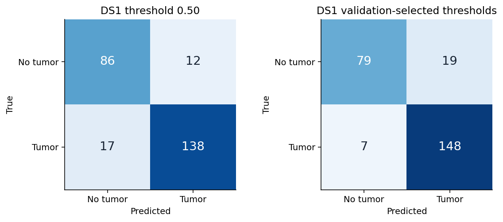
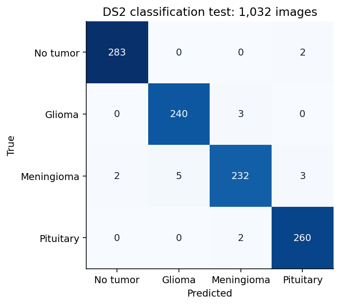
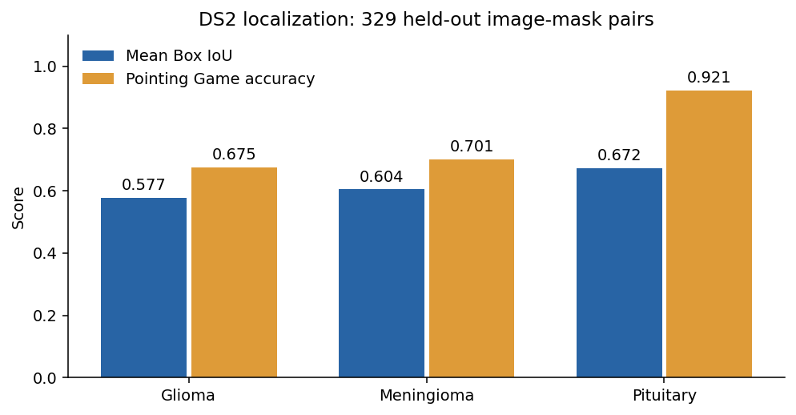
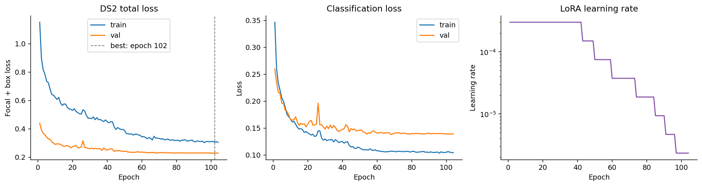

# Báo cáo tuần 3 — ViT-LoRA và tự sinh bounding box

**Thái Văn Huy · 23130068 · BrainTumorDetect**
Lượt thực nghiệm hoàn tất ngày **19/11/2026**. Số liệu dưới đây lấy từ các file trên Drive, được đối chiếu lại với dự đoán từng mẫu; không phải kết quả giả lập.

## 1. Kết quả chính và mức hoàn thành

| Hạng mục | Kết quả đo được | Đối chiếu yêu cầu |
|---|---|---|
| ViT-LoRA r=8, alpha=16 trên DS1 | Đủ 5 fold, 253 dự đoán outer-test riêng biệt | Đã thực hiện |
| Recall có u DS1 sau Threshold Moving | **95,48%**, TP=148/155, FN=7 | **Chưa vượt 96%** |
| ViT-LoRA trên DS2 | Dừng sớm sau 104 epoch; chọn checkpoint epoch 102 | Đã thực hiện |
| Recall có u DS2 ở ngưỡng 0.40 | **99,73%**, TP=745/747, FN=2 | **Vượt 96%** |
| Accuracy phân loại bốn lớp DS2 | **98,35%**, đúng 1.015/1.032 ảnh | Đã đánh giá |
| Mean Box IoU DS2 | **0,6261** trên 329 cặp ảnh-mask test | Đã đánh giá |
| Pointing Game Accuracy DS2 | **78,72%**, 259/329 điểm nằm trong mask | Đã đánh giá |
| Hai checkpoint và tự đồng bộ Drive | Có `loss_best.pth`, `loss_latest.pth`; đã quan sát file mới trên Drive | Đã thực hiện |
| Mong muốn total loss về 0.0x | Best validation total loss **0,2294** | DS2 chưa đạt mốc dưới 0.1 |

Với 155 ảnh có u ở DS1, cần ít nhất **149 TP** để Recall vượt 96%. Lượt này có 148 TP, vì vậy không được ghi DS1 đã đạt mục tiêu. Chưa có thực nghiệm bổ sung để khẳng định sẽ vượt mốc đó.

## 2. Dữ liệu, split và kiểm tra trùng

DS1 giữ nguyên năm fold tuần 2. Mỗi ảnh xuất hiện đúng một lần trong outer-test; mỗi fold dùng validation riêng để chọn checkpoint và ngưỡng.

| Dữ liệu DS2 | Train | Validation | Test |
|---|---:|---:|---:|
| Classification | 4.927 | 1.064 | 1.032 |
| Segmentation | 1.534 | 329 | 329 |
| Tổng | 6.461 | 1.393 | 1.361 |

Split classification tuần 2 là 4.930/1.064/1.029. Sau khi mở rộng nhóm trùng bằng ảnh gốc và ảnh crop/CLAHE, có **một nhóm xung đột**, gồm **ba ảnh chuyển từ train sang test** theo quy tắc cố định `test > val > train`. Giữ tất cả ảnh test cũ, không đưa ảnh validation/test cũ vào train. Xem [data_audit.json](results/data_audit.json) và [ds2_split_changes.csv](results/ds2_split_changes.csv).

Audit ghi DS1 có 253 ảnh/228 nhóm, DS2 có 9.215 ảnh/8.788 nhóm, 2.192 mask và 0 nhóm trùng giữa classification/segmentation. Đây là kiểm tra **trùng chính xác ở cấp ảnh**, chưa xác minh ảnh gần trùng hoặc tính độc lập ở cấp bệnh nhân. Mask được crop đồng bộ và kiểm tra bảo toàn pixel u trong pipeline.

## 3. Cấu hình và môi trường

- Backbone: `google/vit-base-patch16-224-in21k`, input 224 × 224; revision `b4569560a39a0f1af58e3ddaf17facf20ab919b0`.
- LoRA: r=8, alpha=16, query/value của đủ 12 tầng attention (24 module); backbone gốc đóng băng.
- DS1: head nhị phân. DS2: head bốn lớp và box head của repo.
- DS2: 86.598.857 tham số tổng, 800.201 tham số cập nhật (**0,9240%**); riêng LoRA là 294.912 tham số.
- Batch size 8, AMP; AdamW, LR LoRA 0.0003, head/box 0.001, weight decay 0.01, seed 42.
- Phân loại: Focal Loss với class weights từ train, label smoothing 0.05. Box: GIoU + L1; tổng loss bằng phân loại + box, hệ số box 1.0.
- Tối đa 1.000 epoch; early stopping patience=25, min_delta=0.0001. ReduceLROnPlateau patience=5, giảm LR x0.5.
- DS1 và phần đầu DS2 chạy trên Colab; DS2 tiếp tục từ epoch 40 trên Windows bằng RTX 3050 Ti Laptop GPU. Epoch 40–52 chạy CMD, epoch 53–104 chạy qua giao diện Colab kết nối local runtime, giữ cùng trainer/checkpoint.
- Môi trường Windows ghi nhận Python 3.12.16, PyTorch 2.6.0+cu126, CUDA runtime 12.6, transformers 4.57.1, peft 0.17.1, numpy 2.2.6. Xem [runtime](results/environment/local_runtime.json) và [pip freeze](results/environment/pip-freeze-local.txt).

`loss_latest.pth` khôi phục trọng số trainable, optimizer, scheduler, AMP scaler, RNG và counters. `loss_best.pth` chứa LoRA và các head, cần đúng pretrained backbone khi sử dụng. Notebook local sao chép file hoàn chỉnh sang Google Drive for desktop sau mỗi epoch đã lưu; ứng dụng Drive tải lên cloud. Môi trường local không được chia sẻ chỉ bằng việc chia sẻ notebook.

**Chưa thêm warm-up learning rate trong lượt này.** Nếu yêu cầu “lấy đà” được nhóm xác định là warm-up, đó là phần cần làm rõ và thực nghiệm riêng; resume optimizer/scheduler không đồng nghĩa với warm-up.

## 4. DS1 — 5-fold cross-validation

| Fold | Test | Epoch tốt nhất | Epoch đã chạy | Ngưỡng từ validation | TP | FN | Recall test |
|---|---:|---:|---:|---:|---:|---:|---:|
| 1 | 51 | 9 | 34 | 0.40 | 27 | 4 | 87,10% |
| 2 | 51 | 5 | 30 | 0.40 | 31 | 0 | 100,00% |
| 3 | 51 | 3 | 28 | 0.37 | 31 | 0 | 100,00% |
| 4 | 50 | 17 | 42 | 0.40 | 29 | 2 | 93,55% |
| 5 | 50 | 6 | 31 | 0.40 | 30 | 1 | 96,77% |

Recall trung bình trên năm fold là **95,48% ± 5.40 điểm phần trăm** (độ lệch chuẩn mẫu). Không chọn ngưỡng lại từ các dự đoán outer-test.

| Ngưỡng | Accuracy nhị phân | Recall có u | Specificity | TP | TN | FP | FN |
|---|---:|---:|---:|---:|---:|---:|---:|
| 0.50 | 88,54% | 89,03% | 87,76% | 138 | 86 | 12 | 17 |
| Riêng từng fold: 0.40/0.40/0.37/0.40/0.40 | 89,72% | 95,48% | 80,61% | 148 | 79 | 19 | 7 |

Hạ ngưỡng giảm FN từ 17 xuống 7, đồng thời tăng FP từ 12 lên 19. Pooled ROC-AUC là 95,92%. Recall 95,48% vẫn thấp hơn yêu cầu trên 96%; không hạ tiếp ngưỡng dựa vào kết quả test để làm đẹp chỉ số.

Dữ liệu kiểm chứng: [CV summary](results/ds1/cv_summary.json), [253 dự đoán OOF](results/ds1/oof_predictions.csv), [kết quả từng fold](results/ds1/fold_metrics.json).

## 5. DS2 — phân loại và Threshold Moving

Chọn ngưỡng trong 0.35–0.40 chỉ từ **1.064 ảnh classification validation**. Xác suất có u bằng `1 - P(no_tumor)`. Sau khi chọn checkpoint tốt nhất theo validation total loss, chọn ngưỡng đáp ứng Recall validation >96%, ưu tiên Specificity, F1 rồi ngưỡng cao hơn. Ngưỡng được chọn là **0.40**, sau đó cố định khi đánh giá test.

| Chỉ số trên 1.032 ảnh classification test | Kết quả |
|---|---:|
| Accuracy bốn lớp | 98,35% |
| Macro Recall | 98,29% |
| Macro F1 | 98,30% |
| Macro ROC-AUC OvR | 99,77% |
| Accuracy phát hiện có u, tau=0.40 | 99,52% |
| Recall có u, tau=0.40 | 99,73% |
| Specificity, tau=0.40 | 98,95% |
| TP / TN / FP / FN | 745 / 282 / 3 / 2 |

Trên test, ngưỡng 0.50 và 0.40 cho **cùng TP/TN/FP/FN**. Vì vậy lượt này chưa chứng minh Threshold Moving tăng Recall test DS2; Recall ở ngưỡng 0.50 vốn đã trên 96%. Trên validation, ngưỡng 0.40 giảm FN từ 3 xuống 2 nhưng tăng FP từ 5 lên 8.

## 6. DS2 — Mean Box IoU và Pointing Game

Đánh giá trên toàn bộ **329 ảnh-mask segmentation test**, tách khỏi classification test. Auto-Prompt nhận ảnh, không nhận ground-truth box/mask khi tạo dự đoán. Ground truth dùng để chấm điểm.

- Box: box head của repo, padding 8% từ AutoPromptGenerator; so với box suy từ mask.
- Pointing Game: điểm peak dự đoán từ Rollout/LayerCAM nằm trong mask u thật. Đây không phải yêu cầu điểm trùng chính xác trọng tâm hình học khối u.
- Báo cả ungated và toàn pipeline. Ảnh có u bị detector bỏ sót phải tính IoU=0 và point miss trong chỉ số toàn pipeline.

| Lớp | Số mẫu | Mean Box IoU | Pointing Game Accuracy |
|---|---:|---:|---:|
| Glioma | 83 | 0,5766 | 67,47% |
| Meningioma | 107 | 0,6043 | 70,09% |
| Pituitary | 139 | 0,6724 | 92,09% |
| **Tổng** | **329** | **0,6261** | **78,72%** |

Detector nhận có u ở 329/329 mẫu segmentation test, nên chỉ số ungated và toàn pipeline bằng nhau trong lượt này. Có **259 point hit**, **70 point miss**. Kết quả pituitary cao hơn glioma và meningioma ở cả hai chỉ số. Đây là đánh giá định vị, chưa phải đánh giá segmentation bằng Dice/Mask IoU.

## 7. Loss, early stopping và so sánh tuần 2

DS2 dừng ở epoch **104**, checkpoint có validation total loss thấp nhất là epoch **102**, loss **0,2294**. Ở epoch 104, train total loss là 0,3049, validation total loss là 0,2297. Bộ đếm early stopping đạt 25.

Epoch tốt nhất có thể là 102 dù bộ đếm đã đạt 25 ở 104: checkpoint lưu mọi mức loss thấp hơn, còn bộ đếm chỉ reset nếu mức giảm so với best trước đó vượt `min_delta=0.0001`. Các cải thiện rất nhỏ không reset bộ đếm.

Total loss gồm hai nhiệm vụ nên không dùng ngưỡng số học 0.0x để tự kết luận mô hình tốt/xấu. Trong log hiện tại, loss phân loại được trung bình theo mọi ảnh trong batch; loss box được tính trên mẫu có box trong mỗi batch rồi cộng vào batch loss. Tỷ lệ mẫu có mask và việc shuffle khác nhau giữa train/validation ảnh hưởng thang đo phần box. Không suy Mean Box IoU trực tiếp từ `1 - box_loss`. Chỉ số định vị cuối được tính riêng theo từng ảnh test.

Đối chiếu tuần 2 dùng các `summary.json` đang có ở `dev` commit `01b0799`, giữ nguyên file của tuần 2:

| Thực nghiệm | DS1 Recall có u | DS2 Accuracy bốn lớp | Ghi chú |
|---|---:|---:|---|
| Tuần 2 Linear Probing | 81,29% | 80,86% | ViT-Tiny, input 112, CPU |
| Tuần 2 Full Fine-tuning | 89,03% | 93,88% | DS2 test 1.029 ảnh |
| Tuần 3 LoRA, tau=0.50 | 89,03% | 98,35% | ViT-Base, input 224, DS2 test 1.032 ảnh |
| Tuần 3 LoRA + ngưỡng từ validation | 95,48% | Không đổi phân loại bốn lớp | Chỉ thay quyết định có u/không u |

Trên đúng **1.029 ảnh test cũ** của tuần 2, accuracy bốn lớp của tuần 3 là **98,35%**; đây là đối chiếu phụ, kết quả chính vẫn dùng toàn bộ 1.032 ảnh test hiện tại. Backbone, kích thước ảnh, dữ liệu train segmentation, loss và lịch huấn luyện cũng khác, nên không quy toàn bộ thay đổi cho LoRA.

Handoff cũ ghi DS2 Full Fine-tuning 91,45%; `reports/tuan2/vit_baseline/ds2/summary.json` hiện tại ghi **93,88%**. Báo cáo này dùng số trong JSON của repo đã kiểm tra, không trộn hai số như cùng một lượt chạy. Cần truy nguyên lượt cũ nếu nhóm muốn sử dụng 91,45%.

## 8. Kiểm tra và giới hạn

Đã tính lại từ CSV: số lượng/ID duy nhất; dự đoán và ma trận nhầm lẫn; Recall/Specificity; ngưỡng DS2 chọn trên validation; Mean Box IoU từ 329 cặp tọa độ box; trung bình point-hit; lịch sử 104 epoch và checkpoint được chọn. Kết quả khớp JSON. Source fingerprint của chín file cốt lõi khớp checkpoint identity:

`1c84166f333e8e05e80926bb6f9730cd805a1f21882c46e6c6c350c3a22b55d2`

[verification.json](results/verification.json) ghi phạm vi đối chiếu. Trong lượt kiểm tra cuối này, point-hit được tổng hợp lại từ CSV, **chưa tải lại raw mask để chấm lại từng điểm**. Audit ảnh trùng không bảo đảm độc lập ở cấp bệnh nhân. DS1 nhỏ và Recall giữa các fold biến động; không kết luận chất lượng triển khai thực tế chỉ từ các bộ test này.

Kết quả đã hoàn tất về mặt chạy và đánh giá. **Mục tiêu Recall DS1 >96% chưa đạt**; mong muốn DS2 total loss dưới 0.1 và yêu cầu warm-up (nếu có) cũng chưa hoàn thành. Nếu mở thực nghiệm mới, giữ nguyên kết quả này, chọn cấu hình bằng train/validation và không dùng test đã xem để chọn ngưỡng/cấu hình.

## 9. File bàn giao và bước tiếp theo

- Code train: `engine/train_vit_lora_huy.py`; notebook: `notebooks/train.ipynb`; requirements và hướng dẫn trong `experiments/`.
- Checkpoint: lưu trữ nội bộ nhóm trên Google Drive (`Huy/tuan3/ds1` và `Huy/tuan3/ds2`, không đưa lên Git).
- Notebook đã chạy: xem bản sạch output trong `notebooks/train.ipynb` (hỗ trợ Google Colab và local runtime, tự động resume checkpoint).
- Raw CSV/JSON và môi trường nằm trong `results/` của báo cáo; biểu đồ nằm trong `image/tuan3/huy/`.

Trước khi đưa vào GitHub, kiểm tra `git status` ở repo đang làm việc của Huy, lấy `dev` mới nhất và chỉ áp dụng file thuộc phần Huy. Không chép toàn bộ source snapshot đè lên repo mới của nhóm. Checkpoint và dataset giữ trên Drive/đĩa dữ liệu, không đưa vào Git.

Tên PR đề xuất: **Add Huy week 3 ViT-LoRA training and measured DS1/DS2 results**. Nội dung PR phải nêu rõ DS1 Recall 95,48% chưa vượt mục tiêu, DS2 Recall 99,73%, Mean Box IoU 0,6261 và Pointing Game 78,72%. Nhóm cần xem kết quả DS1 và chốt có yêu cầu thực nghiệm bổ sung trước khi đánh dấu hoàn thành toàn bộ chỉ tiêu.
