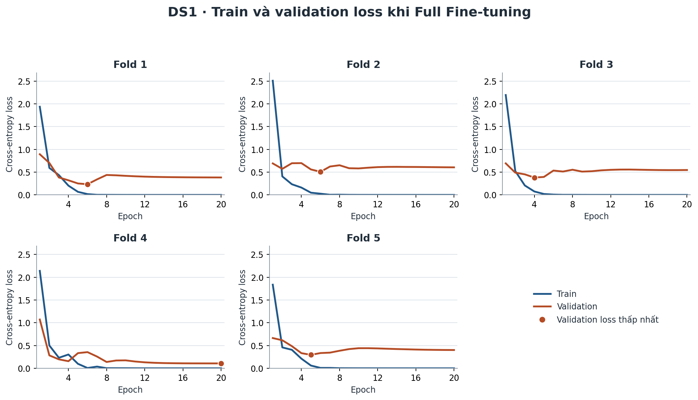
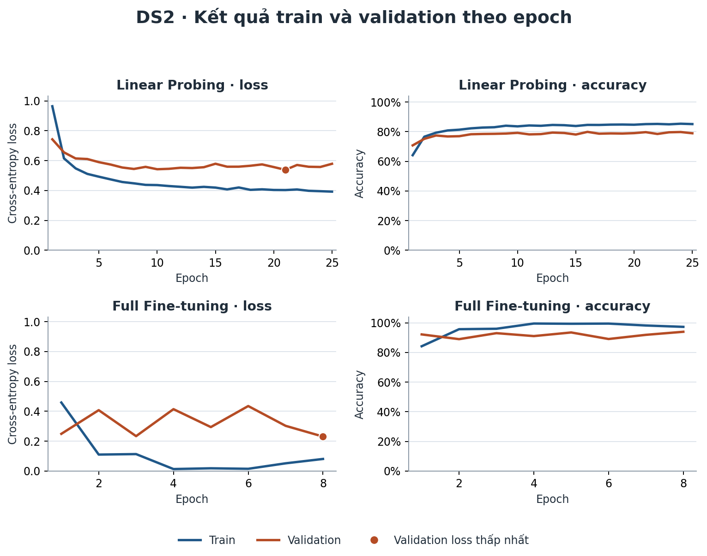

# Thực nghiệm ViT baseline trên hai bộ ảnh MRI

**Thái Văn Huy · 23130068**

Số liệu lấy từ lượt chạy trên Windows ngày 13/11/2026. Các tệp cấu hình, lịch sử huấn luyện và dự đoán dùng trong báo cáo nằm ở commit [0ff153d](https://github.com/MikanQuyt/BrainTumorDetect/commit/0ff153d673869e8db0d2cac68b43ead7bd2d664e).

## Dữ liệu và cách chia tập

DS1 là Navoneel, gồm 253 ảnh, trong đó 155 ảnh có u và 98 ảnh không u. Dùng 5-fold cross-validation phân tầng theo lớp và theo nhóm ảnh trùng. Mỗi lượt giữ một fold để test và dành khoảng 20% số nhóm trong bốn fold còn lại cho validation. Mỗi ảnh được test đúng một lần.

| Fold | Train | Validation | Test |
| --- | ---: | ---: | ---: |
| 1 | 159 | 43 | 51 |
| 2 | 162 | 40 | 51 |
| 3 | 163 | 39 | 51 |
| 4 | 164 | 39 | 50 |
| 5 | 162 | 41 | 50 |

DS2 dùng 7.023 ảnh từ phần classification của Indk214. Chia lại với tỷ lệ mục tiêu 70/15/15. Cột `original_split` trong `splits.csv` ghi thư mục Training hoặc Testing gốc của Kaggle.

| Lớp DS2 | Train | Validation | Test | Tổng |
| --- | ---: | ---: | ---: | ---: |
| Không u | 1.409 | 309 | 282 | 2.000 |
| Glioma | 1.135 | 243 | 243 | 1.621 |
| Meningioma | 1.157 | 246 | 242 | 1.645 |
| Pituitary | 1.229 | 266 | 262 | 1.757 |
| **Tổng** | **4.930** | **1.064** | **1.029** | **7.023** |

Ảnh có cùng kích thước và cùng toàn bộ giá trị pixel xám được giữ trong cùng một tập. Phạm vi kiểm tra trùng lặp là trùng pixel ở cấp ảnh. Tính độc lập theo bệnh nhân chưa được xác minh. [StratifiedGroupKFold](https://scikit-learn.org/stable/modules/generated/sklearn.model_selection.StratifiedGroupKFold.html)

## Cấu hình huấn luyện

Hai chế độ khởi tạo từ cùng checkpoint ViT-Tiny patch 16 pretrained trên ImageNet. Ảnh được crop vùng đầu, tăng tương phản bằng CLAHE, resize về 112 × 112 và chuẩn hóa theo checkpoint. Lượt chạy dùng PyTorch 2.15.0 trên CPU, FP32, batch size 32, seed 42 và weight decay 0,01. [Checkpoint ViT-Tiny](https://huggingface.co/timm/vit_tiny_patch16_224.augreg_in21k_ft_in1k)

| Chế độ | Tham số cập nhật | Learning rate | Epoch DS1 | Epoch DS2 |
| --- | ---: | ---: | ---: | ---: |
| Linear Probing | Lớp phân loại tuyến tính | 0,001 | 25 | 25 |
| Full Fine-tuning | ViT và lớp phân loại | 0,0001 | 20 | 8 |

Hai chế độ dùng cùng cách chia tập và cùng khởi tạo lớp phân loại trong mỗi lượt. Loss là cross-entropy và optimizer là AdamW. Chọn trọng số tại epoch có validation loss thấp nhất để đánh giá một lần trên test.

## Kết quả DS1

Các số dưới đây là trung bình ± độ lệch chuẩn mẫu trên 5 fold. Precision, recall và F1 lấy lớp có u làm lớp dương.

| Chế độ | Accuracy (%) | Precision (%) | Recall có u (%) | F1 (%) |
| --- | ---: | ---: | ---: | ---: |
| Linear Probing | 77,45 ± 6,23 | 82,20 ± 6,46 | 81,29 ± 7,36 | 81,51 ± 5,13 |
| Full Fine-tuning | 88,55 ± 4,65 | 92,27 ± 3,83 | 89,03 ± 9,29 | 90,32 ± 4,62 |

Gộp dự đoán test của cả 5 fold, thu được số ảnh ở từng ô của ma trận nhầm lẫn.

| Chế độ | Đúng không u (TN) | Báo u nhầm (FP) | Bỏ sót u (FN) | Đúng có u (TP) |
| --- | ---: | ---: | ---: | ---: |
| Linear Probing | 70 | 28 | 29 | 126 |
| Full Fine-tuning | 86 | 12 | 17 | 138 |

Linear Probing phát hiện 126/155 ảnh có u và bỏ sót 29 ảnh, tương ứng recall **81,29%**, dưới 88%. Riêng fold 2 đạt 90,32%. Full Fine-tuning phát hiện 138/155 ảnh có u, còn 17 ảnh bị bỏ sót. [Cách tính recall](https://scikit-learn.org/stable/modules/generated/sklearn.metrics.recall_score.html)

### Dấu hiệu overfitting khi Full Fine-tuning

| Fold | Epoch được chọn | Train loss từ epoch chọn đến 20 | Val loss từ epoch chọn đến 20 | Val accuracy ở epoch 20 |
| --- | ---: | ---: | ---: | ---: |
| 1 | 6 | 0,01788 → 0,00002 | 0,2345 → 0,3832 | 86,05% |
| 2 | 6 | 0,02695 → 0,00023 | 0,5079 → 0,6058 | 82,50% |
| 3 | 4 | 0,07560 → 0,00016 | 0,3807 → 0,5468 | 79,49% |
| 4 | 20 | 0,00020 → 0,00020 | 0,1076 → 0,1076 | 97,44% |
| 5 | 5 | 0,06048 → 0,00020 | 0,2956 → 0,4017 | 95,12% |

Cả 5 fold đạt 100% train accuracy ở epoch 20. Ở **4/5 fold**, train loss giảm từ epoch được chọn đến epoch 20, trong khi validation loss tăng. Fold 3 thể hiện rõ nhất, với validation loss tăng từ **0,3807 lên 0,5468** và train loss giảm gần về 0. Fold 4 đạt validation loss thấp nhất ngay tại epoch 20.

## Kết quả DS2

Đánh giá trên 1.029 ảnh test. Macro precision, recall và F1 là trung bình đều trên bốn lớp. Recall phát hiện có u gộp ba loại u thành lớp dương.

| Chế độ | Accuracy (%) | Macro precision (%) | Macro recall (%) | Macro F1 (%) | Recall có u (%) |
| --- | ---: | ---: | ---: | ---: | ---: |
| Linear Probing | 80,86 | 80,32 | 80,21 | 80,12 | 95,58 |
| Full Fine-tuning | 93,88 | 94,00 | 93,54 | 93,62 | 98,66 |

| Lớp | Recall Linear Probing | Recall Full Fine-tuning |
| --- | ---: | ---: |
| Không u | 94,33% | 99,29% |
| Glioma | 76,54% | 89,30% |
| Meningioma | 64,46% | 85,95% |
| Pituitary | 85,50% | 99,62% |

Full Fine-tuning phân loại đúng 966/1.029 ảnh. Epoch được chọn là 21 cho Linear Probing và 8 cho Full Fine-tuning.

Các thư mục kết quả lưu cấu hình, ảnh thuộc từng tập, đường học theo epoch, dự đoán test và ma trận nhầm lẫn. [DS1](ds1/summary.json) · [DS2](ds2/summary.json) · [Hướng dẫn chạy lại](../../experiments/HUONG_DAN_TUAN2.md)
