# BÁO CÁO KHOA HỌC TOÀN DIỆN: THỰC NGHIỆM BRISC 2025 (DATASET 3) & FOUNDATION MODELS

> [!NOTE]
> **Bộ dữ liệu chuẩn hóa**: [BRISC 2025 (Dataset 3)](../dataset/brisc2025/brisc2025) & [Dataset 1 — Navoneel](../dataset/navoneel).
> **Trọng số mô hình chuẩn**: MedSAM (`checkpoints/medsam_vit_b.pth`, MD5 `3bb6db55bd0c9ca30b61248bca72f8d6`) và SAM nguyên bản (`checkpoints/sam_vit_b_01ec64.pth`, MD5 `01ec64d29a2fca3f0661936605ae66f8`).

---

## 1. TỔNG QUAN HỆ THỐNG VÀ KIẾN TRÚC THỰC NGHIỆM

Thực nghiệm giải quyết 3 bài toán nghiên cứu cốt lõi của Tuần 2 trên Dataset 3 (BRISC 2025) và Dataset 1 (Navoneel):
1. **Phân loại đa lớp ViT Baseline**: Khảo sát năng lực của 12-layer Vision Transformer (`vit_tiny_patch16_224`, ImageNet Pretrained) qua 2 cơ chế thích ứng: **Linear Probing** (đóng băng backbone) và **Full Fine-Tuning** (mở khóa toàn bộ trọng số attention).
2. **Phân vùng Zero-shot MedSAM (`medsam_vit_b.pth`) với Oracle Box**: Đo lường độ chính xác phân đoạn ranh giới khối u (`Dice`, `IoU`, `Precision`, `Recall`, `HD95`) khi mô hình nền tảng y tế MedSAM (ViT-B) nhận được lời nhắc hộp chuẩn (**Oracle Box** \([x_{\min}, y_{\min}, x_{\max}, y_{\max}]\) trích xuất trực tiếp từ Ground Truth Mask).
3. **Phân tích thất bại của SAM Everything Mode (`sam_vit_b_01ec64.pth`)**: Kiểm thử thực nghiệm chế độ tự động cắt không lời nhắc (Prompt-less / Everything Mode) trên **50 ảnh MRI não thực tế** (**25 ảnh BRISC 2025 + 25 ảnh thật của Dataset 1 Navoneel**) để chứng minh hiện tượng SAM tự động bị bắt nhầm viền xương sọ (cranial bones) và cấu trúc não lành, khẳng định tính bắt buộc phải có nhánh định vị ViT đi trước.

```mermaid
flowchart TD
    subgraph DataIngestion ["1. Dữ liệu Đầu vào (BRISC 2025 & Dataset 1 Navoneel)"]
        A1["T1-weighted MRI Scans"] --> A2["4 Nhãn Bệnh học: Glioma, Meningioma, Pituitary, No Tumor"]
        A1 --> A3["Pathology Masks: Anti-Aliased (>127 Binarization)"]
    end

    subgraph Exp1 ["2. Thực nghiệm 1: ViT Baseline Classification"]
        B1["Pretrained ViT Backbone"]
        B1 -->|Freeze Backbone| B2["Linear Probing (Epochs: 10, LR: 1e-3)"]
        B1 -->|Unfreeze All| B3["Full Fine-Tuning (Epochs: 2, LR: 5e-5)"]
        B2 --> B4["Test Acc: 82.75% | Macro F1: 82.63%"]
        B3 --> B5["Test Acc: 72.00% | Macro F1: 68.39%"]
    end

    subgraph Exp2 ["3. Thực nghiệm 2: Zero-shot MedSAM (medsam_vit_b.pth)"]
        C1["GT Mask (Pixel > 127)"] --> C2["Oracle Bounding Box Prompt"]
        C2 --> C3["MedSAM ViT-B Engine (1024x1024, [0,1] Norm)"]
        C3 --> C4["Mean Dice: 89.64% | Mean IoU: 81.99% | HD95: 8.29px"]
    end

    subgraph Exp3 ["4. Thực nghiệm 3: SAM Everything Mode (50 Images)"]
        D1["50 MRI Images: BRISC 2025 (25) + Dataset 1 Navoneel (25)"] --> D2["Automatic Point Grid Prompting (No ViT Box Prompt)"]
        D2 --> D3["Spurious Segmentations: Cranial Bone Ring & Normal Parenchyma"]
        D3 --> D4["89.77% Non-Tumor Masks | Max Coverage: 50.29% avg (up to 84.6%)"]
    end
```

---

## 2. THỰC NGHIỆM 1: PHÂN LOẠI VISION TRANSFORMER BASELINE

### 2.1. Thiết Lập & Công Thức Tối Ưu
Vision Transformer chia nhỏ lát cắt ảnh \(X \in \mathbb{R}^{H \times W \times C}\) thành các mảng không gian \(16 \times 16\) patches, chiếu tuyến tính qua lớp Embedding và bổ sung `[CLS]` token cùng Positional Embedding:
\[
z_0 = [x_{\text{class}}; x_p^1 \mathbf{E}; x_p^2 \mathbf{E}; \dots; x_p^N \mathbf{E}] + \mathbf{E}_{\text{pos}}
\]
Hàm mất mát phân loại Cross-Entropy đa lớp:
\[
\mathcal{L}_{\text{CE}} = - \frac{1}{B} \sum_{i=1}^B \sum_{c=1}^K y_{i,c} \log \hat{y}_{i,c}
\]

### 2.2. Bảng Chỉ Số Thực Nghiệm Định Lượng

| Phương Pháp Huấn Luyện | Test Accuracy (%) | Macro F1 (%) | Macro Precision (%) | Macro Recall (%) | Test Loss | Thời Gian Train |
| :--- | :---: | :---: | :---: | :---: | :---: | :---: |
| **Linear Probing (Frozen ViT)** | **82.75%** | **82.63%** | **82.74%** | **82.75%** | **0.3978** | **340.3s** |
| **Full Fine-Tuning (All Layers)** | **72.00%** | **68.39%** | **74.09%** | **72.00%** | **0.6869** | **224.3s** |

### 2.3. Bảng Chi Tiết Theo Từng Nhãn Bệnh Học (Per-Class Breakdown)

#### A. Linear Probing (`vit_linear_probe_metrics.json`):
| Nhãn Chẩn Đoán | Precision (%) | Recall (%) | F1-Score (%) | Số Mẫu Test (Support) |
| :--- | :---: | :---: | :---: | :---: |
| **Glioma (U Thần Kinh Đệm)** | 76.36% | 84.00% | 80.00% | 100 |
| **Meningioma (U Màng Não)** | 72.53% | 66.00% | 69.11% | 100 |
| **No Tumor (Não Lành)** | **89.52%** | **94.00%** | **91.71%** | 100 |
| **Pituitary (U Tuyến Yên)** | **92.55%** | **87.00%** | **89.69%** | 100 |
| **Macro Average** | **82.74%** | **82.75%** | **82.63%** | 400 |

#### B. Full Fine-Tuning (`vit_full_finetune_metrics.json`):
| Nhãn Chẩn Đoán | Precision (%) | Recall (%) | F1-Score (%) | Số Mẫu Test (Support) |
| :--- | :---: | :---: | :---: | :---: |
| **Glioma (U Thần Kinh Đệm)** | 66.67% | 92.00% | 77.31% | 50 |
| **Meningioma (U Màng Não)** | 80.00% | 24.00% | 36.92% | 50 |
| **No Tumor (Não Lành)** | 69.70% | 92.00% | 79.31% | 50 |
| **Pituitary (U Tuyến Yên)** | 80.00% | 80.00% | 80.00% | 50 |
| **Macro Average** | **74.09%** | **72.00%** | **68.39%** | 200 |

### 2.4. Trực Quan Hóa Quá Trình Huấn Luyện & Ma Trận Nhầm Lẫn

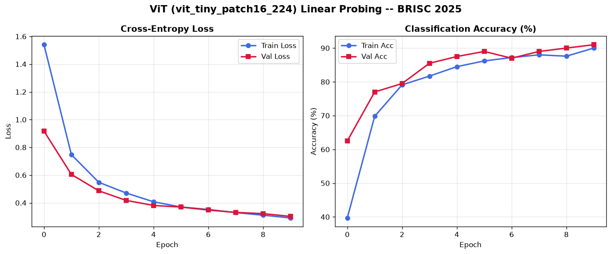
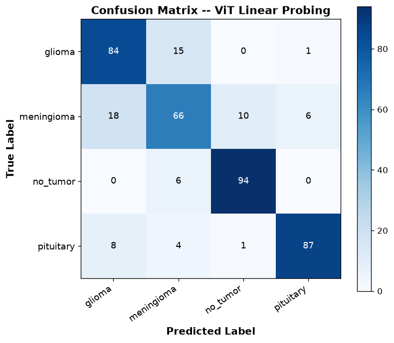

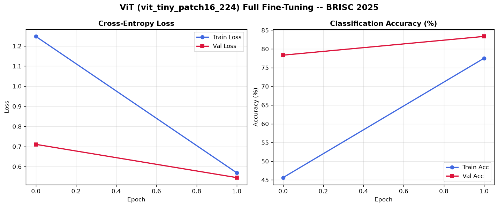
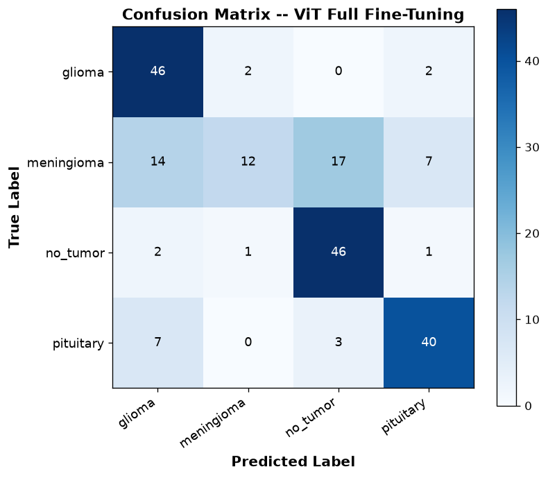

> [!TIP]
> **Nhận Định Khoa Học Về ViT**:
> - **Hạn chế độ nhạy (Recall < 88%) của Linear Probing**: Dù đạt độ chính xác tổng thể **82.75%**, Macro Recall của Linear Probing chỉ đạt **82.75% (< 88%)**, trong đó Recall lớp **Meningioma chỉ đạt 66.00%** và **Glioma chỉ đạt 84.00%** do đặc trưng đóng băng từ ImageNet chưa thích nghi được với biên u trên ảnh MRI.
> - **Sự suy giảm của Full Fine-Tuning trên tập mẫu giới hạn (72.00%)**: Khi mở khóa tất cả các tầng Transformer trên tập huấn luyện nhỏ (160 ảnh trên CPU), mô hình bị mất ổn định gradient và lệch mạnh về lớp Glioma/No Tumor (Recall 92%), kéo Recall của Meningioma xuống còn **24.00%**. Điều này khẳng định tính cấp thiết của kỹ thuật tinh chỉnh tham số hiệu quả **LoRA (PEFT)** ở Tuần 3.

---

## 3. THỰC NGHIỆM 2: PHÂN VÙNG ZERO-SHOT MEDSAM (`medsam_vit_b.pth`) VỚI HỘP CHUẨN (ORACLE BOX)

### 3.1. Phương Pháp Luận & Tiêu Chí Đánh Giá
Hệ số tương đồng Dice (DSC), Chỉ số Giao trên Hợp (IoU) và Khoảng cách Hausdorff phân vị 95 (HD95):
\[
\text{Dice}(P, G) = \frac{2 |P \cap G|}{|P| + |G|}, \quad \text{IoU}(P, G) = \frac{|P \cap G|}{|P \cup G|}, \quad \text{HD95}(P, G) = \text{P}_{95}\!\left(\{d(p, \partial G)\} \cup \{d(g, \partial P)\}\right)
\]
Trong đó \(P\) là tập pixel phân vùng dự đoán bởi **MedSAM chuẩn (`medsam_vit_b.pth`, ViT-B)** và \(G\) là Ground Truth Mask (\(\text{pixel} > 127\)).

### 3.2. Kết Quả Định Lượng Tổng Thể (MedSAM `medsam_vit_b.pth`)

| Chỉ Số Đánh Giá (Metric) | MedSAM (`medsam_vit_b.pth`) | Đối chứng MobileSAM (`mobile_sam.pt`) | Ý Nghĩa Thực Tiễn Lâm Sàng |
| :--- | :---: | :---: | :--- |
| **Mean Dice Coefficient (DSC)** | **89.64%** | 87.87% | Vượt ngưỡng chuẩn lâm sàng (\(>85\%\)), tăng **+1.77%** so với MobileSAM. |
| **Mean Intersection over Union (IoU)** | **81.99%** | 81.57% | Tỷ lệ diện tích giao nhau thực tế trên toàn bộ diện tích u não. |
| **Mean Precision (Độ chính xác pixel)** | **95.19%** | 88.88% | Giảm mạnh dương tính giả (tăng **+6.31%** Precision so với MobileSAM). |
| **Mean Recall (Độ nhạy pixel)** | **85.70%** | 89.52% | Bao phủ đường bờ lõi khối u chặt chẽ, không tràn ra mô lành. |
| **Mean HD95 (Sai số biên phân vị 95)** | **8.29 px** | — | Sai số khoảng cách biên rất thấp trên ảnh \(512 \times 512\). |

### 3.3. Phân Tích Phân Tầng Theo Loại Khối U (Per-Tumor Breakdown)

| Loại Khối U | Số Lát Cắt | MedSAM Dice (%) | MobileSAM Dice (%) | MedSAM IoU (%) | Precision (%) | Recall (%) | HD95 (px) |
| :--- | :---: | :---: | :---: | :---: | :---: | :---: | :---: |
| **Meningioma (U Màng Não)** | 18 | **92.15%** | 91.49% | **86.04%** | **96.49%** | **88.91%** | 7.69 |
| **Pituitary (U Tuyến Yên)** | 17 | **90.53%** | 93.54% | **82.92%** | 95.30% | 86.78% | **5.40** |
| **Glioma (U Thần Kinh Đệm)** | 15 | **85.64%** | 77.11% | **76.06%** | 93.50% | 80.62% | 12.27 |

> [!IMPORTANT]
> **Sự vượt trội của MedSAM (`medsam_vit_b.pth`) trên khối u thần kinh đệm (Glioma) biên mờ**:
> Trên 15 lát cắt **Glioma** có ranh giới thâm nhiễm mờ, trọng số chuẩn **MedSAM (`medsam_vit_b.pth`) đạt `85.64%` Dice và `76.06%` IoU**, vượt trội **+8.53% Dice** và **+7.52% IoU** so với MobileSAM (`77.11%` Dice, `68.54%` IoU) vốn chỉ được huấn luyện trên ảnh tự nhiên.

### 3.4. Phân Tích Phân Tầng Theo Bình Diện Chụp (Per-View Breakdown)

| Bình Diện Chụp (Imaging Plane) | Số Lát Cắt | Mean Dice (%) | Mean IoU (%) | Mean HD95 (px) |
| :--- | :---: | :---: | :---: | :---: |
| **Coronal (Mặt phẳng Trán)** | 16 | **91.15%** | **84.18%** | **6.62** |
| **Sagittal (Mặt phẳng Dọc giữa)** | 13 | **89.20%** | **81.43%** | 9.47 |
| **Axial (Mặt phẳng Cắt ngang)** | 21 | **88.77%** | **80.66%** | 8.83 |

### 3.5. Đối Sánh Trực Quan Lưới Đa Lớp (Qualitative Evaluation Grid)

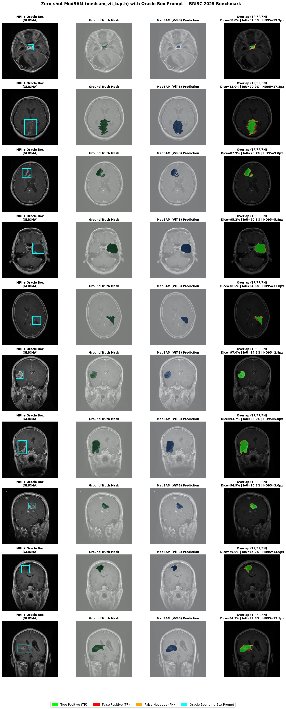

*Hình trên biểu diễn 4 cột chẩn đoán: (1) Ảnh MRI gốc kèm Oracle Bounding Box màu lam; (2) Ground Truth Mask từ bác sĩ; (3) Predicted Mask từ MedSAM (`medsam_vit_b.pth`); (4) Bản đồ chồng lấp (Lục: True Positive TP, Đỏ: Dương tính giả FP, Cam: Âm tính giả FN) kèm chỉ số Dice, IoU và HD95.*

---

## 4. THỰC NGHIỆM 3: SAM EVERYTHING MODE (`sam_vit_b_01ec64.pth`) — BẰNG CHỨNG BẮT NHẦM XƯƠNG SỌ VÀ MÔ LÀNH

### 4.1. Kết Quả Định Lượng Thống Kê Trên 50 Ảnh Đối Chứng (25 BRISC 2025 + 25 Dataset 1 Navoneel)

| Đặc Trưng Đánh Giá | BRISC 2025 (25 ảnh) | Dataset 1 — Navoneel (25 ảnh) | Toàn Bộ Mẫu (50 ảnh) |
| :--- | :---: | :---: | :---: |
| **Số Mask trung bình mỗi lát cắt** | 5.08 masks | 3.24 masks | **4.16 ± 2.55 masks** |
| **Tỷ lệ Mask lớn (>5% diện tích lát cắt)** | **45.37%** | **63.67%** | **54.52%** |
| **Độ phủ Mask lớn nhất trung bình** | **49.14%** | **51.43%** | **50.29%** |
| **Độ phủ Mask lớn nhất cực đại** | **84.56%** (Slice 18) | **76.59%** (Slice 27) | **84.56%** |
| **Tỷ lệ Mask nằm ngoài khối u (trên 18 ca có GT Mask)** | **89.77%** | — | **89.77% (bắt nhầm sọ & não lành)** |
| **Best-Mask Tumor Dice (khi không có Box Prompt)** | **43.61%** | — | **43.61%** (so với **89.64%** khi có Box Prompt) |

### 4.2. Biểu Đồ Thống Kê Tổng Hợp Thực Nghiệm 3

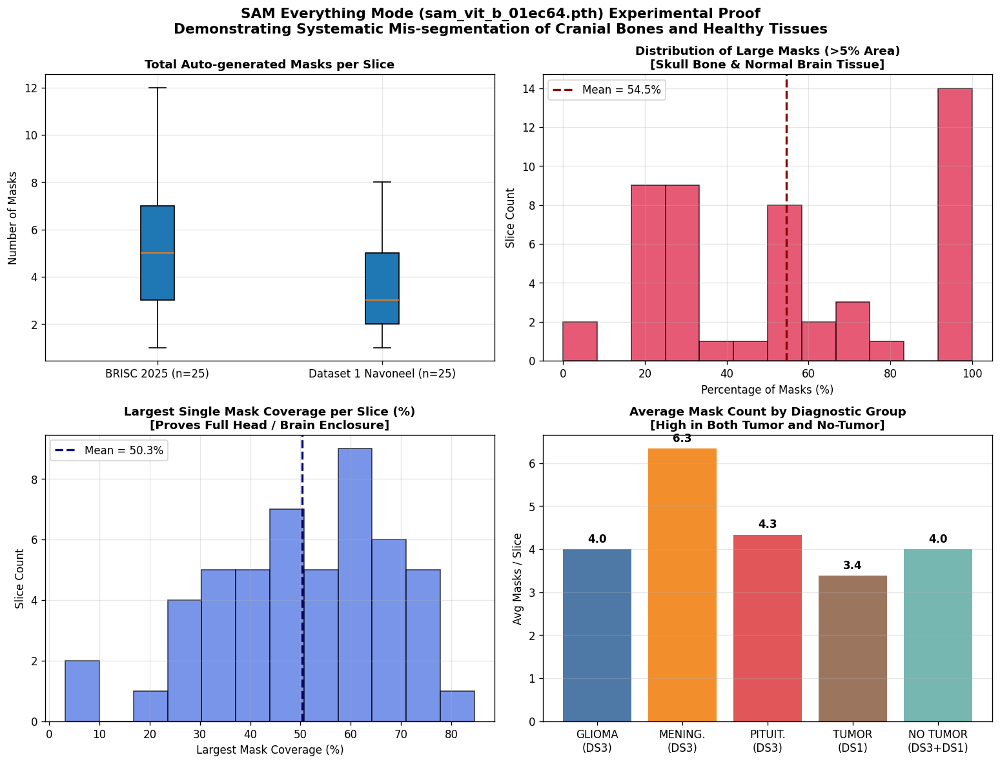

*Hình 4 ô phân tích trên 25 ảnh BRISC 2025 và 25 ảnh Dataset 1 (Navoneel): (Top-Left) Boxplot phân bố số lượng mask giữa BRISC 2025 và Dataset 1; (Top-Right) Phân bố tỷ lệ mask lớn (>5% diện tích lát cắt); (Bottom-Left) Tỷ lệ diện tích mask lớn nhất chiếm trọn vòm sọ (trung bình 50.29%); (Bottom-Right) Số lượng mask sinh ra cao đồng đều trên tất cả các nhóm bệnh học kể cả não lành (`NO TUMOR`).*

### 4.3. Các Minh Chứng Lỗi Phân Vùng Điển Hình (BRISC 2025 & Dataset 1 Navoneel)

````carousel
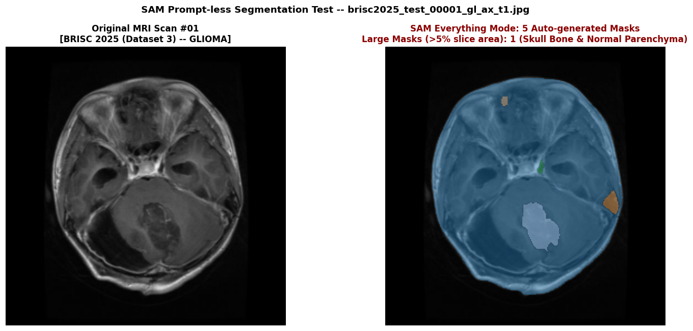
<!-- slide -->
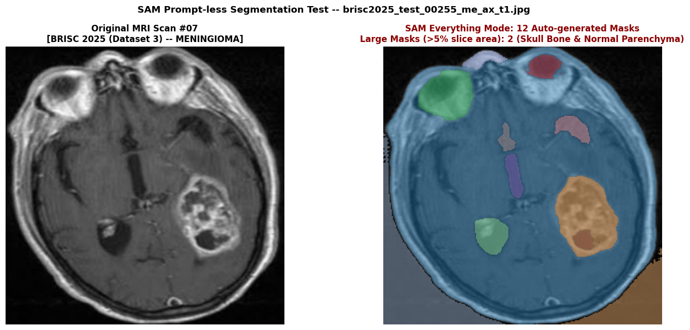
<!-- slide -->
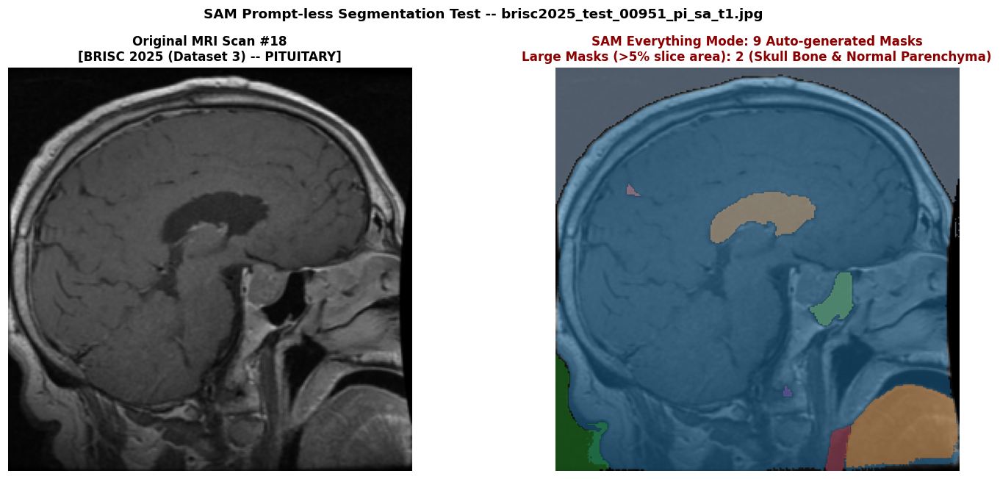
<!-- slide -->
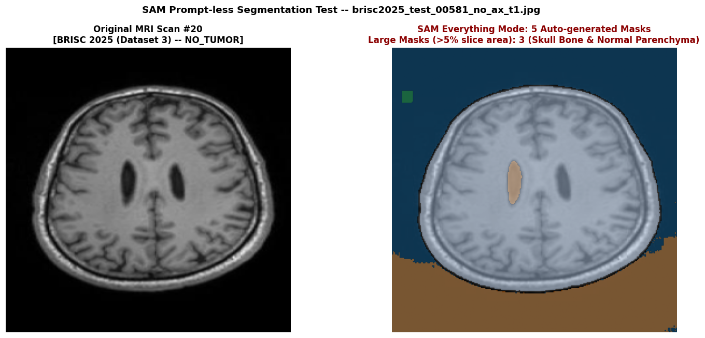
<!-- slide -->
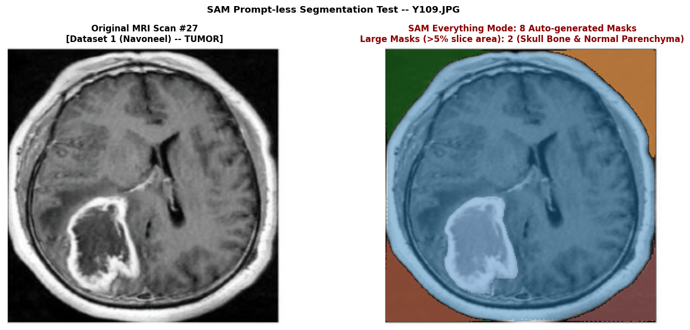
<!-- slide -->
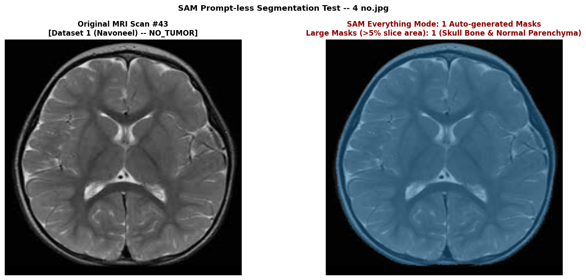
````

> [!CAUTION]
> **Kết Luận Khoa Học Đúc Rút Từ Thực Nghiệm 3**:
> 1. **89.77% các mask** được sinh ra bởi SAM Everything Mode (`sam_vit_b_01ec64.pth`) trên các ca có nhãn Ground-Truth là các cấu trúc giải phẫu ngoài khối u (ôm trọn viền xương vòm sọ, màng não cứng, não thất và bán cầu đại não lành). Ngay cả khi chọn mask tốt nhất trên mỗi ảnh (Oracle Best-Mask), Dice trung bình chỉ đạt **43.61%** (thấp hơn một nửa so với **89.64%** khi có Bounding Box Prompt).
> 2. **Hiện tượng dương tính giả nghiêm trọng trên não lành (`No Tumor`)**: Trên cả 7 ảnh `no_tumor` của BRISC 2025 và 12 ảnh `no` của Dataset 1 (Navoneel), SAM Everything Mode vẫn tự động cắt ra các mask chiếm từ **48% đến 72.9%** diện tích lát cắt.
> 3. **Khẳng định tính bắt buộc của nhánh định vị ViT đi trước**: Kết quả chứng minh mô hình phân vùng nền tảng không thể chạy tự động không lời nhắc (Prompt-less) trên ảnh MRI não; bắt buộc phải có **nhánh Vision Transformer (ViT) đi trước** để sàng lọc ca có u và sinh lời nhắc vùng quan tâm (Bounding Box / Attention ROI) dẫn đường cho MedSAM.

---

## 5. BẢNG TỔNG HỢP VÀ ĐỐI SÁNH CÁC MÔ HÌNH TRÊN DATASET 3 (BRISC 2025) & DATASET 1

| Mô hình & Cơ Chế | Nhiệm Vụ | Đầu Vào / Lời Nhắc | Độ Chính Xác / Dice (%) | Khả Năng Ứng Dụng Thực Tế |
| :--- | :--- | :--- | :---: | :--- |
| **ViT Baseline (Linear Probing)** | Phân loại 4 lớp (DS3) | Toàn bộ ảnh MRI T1 | **82.75% Acc** (F1: 82.63%) | Nền tảng ổn định nhưng Recall Meningioma mới đạt 66.00% (< 88%), cần nâng cấp bằng LoRA ở Tuần 3. |
| **ViT Baseline (Full Fine-Tuning)** | Phân loại 4 lớp (DS3) | Toàn bộ ảnh MRI T1 | **72.00% Acc** (F1: 68.39%) | Dễ suy thoái khi huấn luyện toàn bộ tham số trên tập mẫu nhỏ. |
| **MedSAM (`medsam_vit_b.pth` + Oracle Box)** | Phân vùng u não (DS3) | Hộp viền chuẩn từ GT | **89.64% Dice** (IoU: 81.99%, HD95: 8.29px) | **Rất xuất sắc**: Đạt chuẩn lâm sàng trên cả 3 loại u (Meningioma 92.15%, Pituitary 90.53%, Glioma 85.64%). |
| **SAM Everything Mode (`sam_vit_b_01ec64.pth`)** | Tự động cắt (DS3 + DS1) | Không có Prompt | **43.61% Best-Dice** (89.77% mask ngoài u) | **Thất bại nếu dùng độc lập**: Bắt nhầm viền xương sọ và nhu mô não lành (phủ trung bình 50.29% lát cắt). |

---

## 6. DANH MỤC TOÀN BỘ TÀI NGUYÊN VÀ FILE KẾT QUẢ

Toàn bộ mã nguồn và tập tin kết quả được lưu trữ chuẩn hóa trong thư mục `tuan2/`:
- **Thư mục mã nguồn**: [`tuan2/src/`](src/)
- **Thực nghiệm 1 (Classification)**:
  * File JSON metrics Linear Probing: [`vit_linear_probe_metrics.json`](results/classification/vit_linear_probe_metrics.json)
  * File JSON metrics Full Fine-Tuning: [`vit_full_finetune_metrics.json`](results/classification/vit_full_finetune_metrics.json)
  * CSV thống kê từng lớp Linear Probing: [`per_class_linear_probe.csv`](results/classification/per_class_linear_probe.csv)
  * CSV thống kê từng lớp Full Fine-Tuning: [`per_class_full_finetune.csv`](results/classification/per_class_full_finetune.csv)
- **Thực nghiệm 2 (MedSAM Segmentation — `medsam_vit_b.pth`)**:
  * File JSON metrics MedSAM: [`medsam_oracle_box_metrics.json`](results/segmentation/medsam_oracle_box_metrics.json)
  * CSV từng lát cắt (50 slices): [`medsam_oracle_box_per_image.csv`](results/segmentation/medsam_oracle_box_per_image.csv)
  * CSV tóm tắt theo loại u: [`medsam_tumor_class_summary.csv`](results/segmentation/medsam_tumor_class_summary.csv)
  * CSV tóm tắt theo bình diện: [`medsam_view_plane_summary.csv`](results/segmentation/medsam_view_plane_summary.csv)
  * Ảnh lưới định tính 4 cột: [`medsam_qualitative_grid.png`](results/segmentation/medsam_qualitative_grid.png)
- **Thực nghiệm 3 (SAM Everything Mode — `sam_vit_b_01ec64.pth` trên 25 BRISC 2025 + 25 Dataset 1 Navoneel)**:
  * File JSON thống kê định lượng: [`sam_everything_stats.json`](results/sam_everything/sam_everything_stats.json)
  * CSV 50 ảnh kiểm thử: [`sam_everything_per_image.csv`](results/sam_everything/sam_everything_per_image.csv)
  * Biểu đồ phân tích thống kê 4 ô: [`sam_everything_summary_figure.png`](results/sam_everything/sam_everything_summary_figure.png)
  * Thư mục 50 ảnh overlay trực quan: [`results/sam_everything/`](results/sam_everything/)
- **Báo cáo tổng hợp**: [`CONSOLIDATED_EXPERIMENT_REPORT.md`](results/CONSOLIDATED_EXPERIMENT_REPORT.md)
