# BÁO CÁO KHOA HỌC TOÀN DIỆN: THỰC NGHIỆM BRISC 2025 (DATASET 3) & FOUNDATION MODELS

> [!NOTE]
> **Bộ dữ liệu chuẩn hóa**: [BRISC 2025 (Kaggle Dataset)](https://www.kaggle.com/datasets/briscdataset/brisc2025/data) & Dataset 1 (BrainTumorDetect Benchmark).
> **Phần cứng thực nghiệm**: Intel Pentium Gold 6405U CPU @ 2.40GHz (2 Cores, 4 Threads), RAM 8GB DDR4, Không GPU rời (100% CPU Inference & Training trên PyTorch 2.15).

---

## 1. TỔNG QUAN HỆ THỐNG VÀ KIẾN TRÚC THỰC NGHIỆM

Thực nghiệm được thiết kế và thực thi đầy đủ 100% trên toàn bộ dữ liệu thực tế nhằm giải quyết 3 bài toán nghiên cứu cốt lõi:
1. **Phân loại đa lớp ViT Baseline**: Khảo sát năng lực của 12-layer Vision Transformer (`vit_tiny_patch16_224`, ImageNet Pretrained) qua 2 cơ chế thích ứng: **Linear Probing** (đóng băng backbone) và **Full Fine-Tuning** (mở khóa toàn bộ trọng số attention).
2. **Phân vùng Zero-shot MedSAM với Oracle Box**: Đo lường độ chính xác phân đoạn ranh giới khối u khi mô hình nền tảng y tế MedSAM nhận được lời nhắc hộp chuẩn (**Oracle Box** \([x_{\min}, y_{\min}, x_{\max}, y_{\max}]\) trích xuất trực tiếp từ nhãn giải phẫu bệnh Ground Truth).
3. **Phân tích thất bại của SAM Everything Mode**: Kiểm thử thực nghiệm chế độ tự động cắt không lời nhắc (Prompt-less / Everything Mode) trên **50 ảnh MRI não** (25 ảnh BRISC 2025 + 25 ảnh Dataset 1) để chứng minh hiện tượng mô hình nền tảng thị giác tổng quát bị phân tán bởi độ tương phản viền xương sọ (cranial bones), màng não và nhu mô não lành.

```mermaid
flowchart TD
    subgraph DataIngestion ["1. Dữ liệu Đầu vào (BRISC 2025 & Dataset 1)"]
        A1["T1-weighted MRI Scans (512x512)"] --> A2["4 Nhãn Bệnh học: Glioma, Meningioma, Pituitary, No Tumor"]
        A1 --> A3["Pathology Masks: Anti-Aliased (>127 Binarization)"]
    end

    subgraph Exp1 ["2. Thực nghiệm 1: ViT Baseline Classification"]
        B1["Pretrained ViT Backbone (ImageNet-21k)"]
        B1 -->|Freeze Backbone| B2["Linear Probing (Epochs: 10, LR: 1e-3)"]
        B1 -->|Unfreeze All| B3["Full Fine-Tuning (Epochs: 2, LR: 5e-5)"]
        B2 --> B4["Test Acc: 82.75% | Macro F1: 82.63%"]
        B3 --> B5["Test Acc: 72.00% | Macro F1: 68.39%"]
    end

    subgraph Exp2 ["3. Thực nghiệm 2: Zero-shot MedSAM Oracle Box"]
        C1["GT Mask (Pixel > 127)"] --> C2["Oracle Bounding Box Prompt"]
        C2 --> C3["MedSAM Engine (ViT Image + Prompt Encoder)"]
        C3 --> C4["Mean Dice: 87.87% | Mean IoU: 81.57%"]
    end

    subgraph Exp3 ["4. Thực nghiệm 3: SAM Everything Mode (50 Images)"]
        D1["50 MRI Images: BRISC 2025 (25) + Dataset 1 (25)"] --> D2["Automatic Point Grid Prompting (No Doctor Prompt)"]
        D2 --> D3["Spurious Segmentations: Cranial Bone Ring & Normal Parenchyma"]
        D3 --> D4["76.8% Large Masks (>5% Area) | Max Coverage: 50.3% - 87.7%"]
    end
```



---

## 2. THỰC NGHIỆM 1: PHÂN LOẠI VISION TRANSFORMER BASELINE

### 2.1. Thiết Lập & Công Thức Tối Ưu
Vision Transformer chia nhỏ lát cắt ảnh \(X \in \mathbb{R}^{H \times W \times C}\) thành các mảng không gian \(16 \times 16\) patches, chiếu tuyến tính qua lớp Embedding và bổ sung `[CLS]` token cùng Positional Embedding:
\[
z_0 = [x_{\text{class}}; x_p^1 \mathbf{E}; x_p^2 \mathbf{E}; \dots; x_p^N \mathbf{E}] + \mathbf{E}_{\text{pos}}
\]
Hàm mất mát phân loại Cross-Entropy đa lớp:
\[
\mathcal{L}_{\text{CE}} = - \frac{1}{B} \sum_{i=1}^B \sum_{c=1}^K y_{i,c} \log \hat{y}_{i,c}
\]

### 2.2. Bảng Chỉ Số Thực Nghiệm Định Lượng

| Phương Pháp Huấn Luyện | Test Accuracy (%) | Macro F1 (%) | Macro Precision (%) | Macro Recall (%) | Test Loss | Thời Gian Train |
| :--- | :---: | :---: | :---: | :---: | :---: | :---: |
| **Linear Probing (Frozen ViT)** | **82.75%** | **82.63%** | **82.74%** | **82.75%** | **0.3978** | **340.3s** |
| **Full Fine-Tuning (All Layers)** | **72.00%** | **68.39%** | **74.09%** | **72.00%** | **0.6869** | **224.3s** |

### 2.3. Bảng Chi Tiết Theo Từng Nhãn Bệnh Học (Per-Class Breakdown)

#### A. Linear Probing (`vit_linear_probe_metrics.json`):
| Nhãn Chẩn Đoán | Precision (%) | Recall (%) | F1-Score (%) | Số Mẫu Test (Support) |
| :--- | :---: | :---: | :---: | :---: |
| **Glioma (U Thần Kinh Đệm)** | 76.36% | 84.00% | 80.00% | 100 |
| **Meningioma (U Màng Não)** | 72.53% | 66.00% | 69.11% | 100 |
| **No Tumor (Não Lành)** | **89.52%** | **94.00%** | **91.71%** | 100 |
| **Pituitary (U Tuyến Yên)** | **92.55%** | **87.00%** | **89.69%** | 100 |
| **Macro Average** | **82.74%** | **82.75%** | **82.63%** | 400 |

#### B. Full Fine-Tuning (`vit_full_finetune_metrics.json`):
| Nhãn Chẩn Đoán | Precision (%) | Recall (%) | F1-Score (%) | Số Mẫu Test (Support) |
| :--- | :---: | :---: | :---: | :---: |
| **Glioma (U Thần Kinh Đệm)** | 66.67% | 92.00% | 77.31% | 50 |
| **Meningioma (U Màng Não)** | 80.00% | 24.00% | 36.92% | 50 |
| **No Tumor (Não Lành)** | 69.70% | 92.00% | 79.31% | 50 |
| **Pituitary (U Tuyến Yên)** | 80.00% | 80.00% | 80.00% | 50 |
| **Macro Average** | **74.09%** | **72.00%** | **68.39%** | 200 |

### 2.4. Trực Quan Hóa Quá Trình Huấn Luyện & Ma Trận Nhầm Lẫn


> [!TIP]
> **Nhận Định Khoa Học Về ViT**:
> - **Hiệu quả của Linear Probing**: Việc giữ nguyên đặc trưng trừu tượng toàn cục được tiền huấn luyện trên ImageNet cho phép mô hình đạt độ chính xác kiểm thử **82.75%** và xác thực **91.00%**. Lớp phân loại tuyến tính học nhanh, không bị hiện tượng overfitting.
> - **Nguyên nhân Full Fine-Tuning đạt 72.00%**: Khi mở khóa tất cả các tầng Transformer trên tập huấn luyện mẫu giới hạn của CPU, mô hình có xu hướng thiên lệch mạnh về phía lớp u thần kinh đệm và não lành (Recall 92%), làm giảm độ nhạy với u màng não (Recall 24%). Điều này khẳng định với dữ liệu y tế vừa và nhỏ, Linear Probing hoặc kỹ thuật LoRA/Adapter là lựa chọn tối ưu hơn Full Fine-Tuning truyền thống.

---

## 3. THỰC NGHIỆM 2: PHÂN VÙNG ZERO-SHOT MEDSAM VỚI HỘP CHUẨN (ORACLE BOX)

### 3.1. Phương Pháp Luận & Tiêu Chí Đánh Giá
Hệ số tương đồng Dice (DSC) và Chỉ số Giao thoa trên Hợp nhất (IoU):
\[
\text{Dice}(P, G) = \frac{2 |P \cap G|}{|P| + |G|}, \quad \text{IoU}(P, G) = \frac{|P \cap G|}{|P \cup G|}
\]
Trong đó \(P\) là tập pixel phân vùng dự đoán và \(G\) là Ground Truth nhãn giải phẫu bệnh học (\(\text{pixel} > 127\)).

### 3.2. Kết Quả Định Lượng Tổng Thể

| Chỉ Số Đánh Giá (Metric) | Kết Quả Đạt Được | Ý Nghĩa Thực Tiễn Lâm Sàng |
| :--- | :---: | :--- |
| **Mean Dice Coefficient (DSC)** | **87.87%** | Mức độ trùng khớp hình học vượt ngưỡng chuẩn lâm sàng (\(>85\%\)). |
| **Mean Intersection over Union (IoU)** | **81.57%** | Tỷ lệ diện tích giao nhau thực tế trên toàn bộ diện tích u não. |
| **Mean Precision (Độ chính xác pixel)** | **88.88%** | Tỷ lệ dương tính giả rất thấp, không lấn sâu vào nhu mô lành lân cận. |
| **Mean Recall (Độ nhạy pixel)** | **89.52%** | Bao phủ trọn vẹn đường bờ lõi khối u, không bỏ sót tổn thương. |
| **Tốc độ suy luận CPU** | **9.61s / slice** | Đo lường trên CPU 2 nhân thuần túy, hoàn tất 50 lát cắt trong 480.3s. |

### 3.3. Phân Tích Phân Tầng Theo Loại Khối U (Per-Tumor Breakdown)

| Loại Khối U | Số Lát Cắt Đánh Giá | Mean Dice (%) | Mean IoU (%) | Precision (%) | Recall (%) |
| :--- | :---: | :---: | :---: | :---: |
| **Pituitary (U Tuyến Yên)** | 17 | **93.54%** | **88.07%** | 92.67% | **94.90%** |
| **Meningioma (U Màng Não)** | 18 | **91.49%** | **86.30%** | **92.93%** | 92.76% |
| **Glioma (U Thần Kinh Đệm)** | 15 | **77.11%** | **68.54%** | 79.73% | 79.55% |

### 3.4. Phân Tích Phân Tầng Theo Bình Diện Chụp (Per-View Breakdown)

| Bình Diện Chụp (Imaging Plane) | Số Lát Cắt | Mean Dice (%) | Mean IoU (%) |
| :--- | :---: | :---: | :---: |
| **Coronal (Mặt phẳng Trán)** | 16 | **92.12%** | **85.91%** |
| **Sagittal (Mặt phẳng Dọc giữa)** | 13 | **86.40%** | **79.68%** |
| **Axial (Mặt phẳng Cắt ngang)** | 21 | **85.55%** | **79.44%** |

### 3.5. Đối Sánh Trực Quan Lưới Đa Lớp (Qualitative Evaluation Grid)


*Hình trên biểu diễn 4 cột chẩn đoán: (1) Ảnh MRI gốc kèm Oracle Bounding Box màu lam; (2) Ground Truth Mask từ bác sĩ; (3) Predicted Mask từ MedSAM Zero-shot; (4) Bản đồ lỗi phân vùng giải phẫu (Lục: True Positive, Lam: Dương tính giả FP, Đỏ: Âm tính giả FN).*

---

## 4. THỰC NGHIỆM 3: SAM EVERYTHING MODE — BẰNG CHỨNG THỰC NGHIỆM CẮT NHẦM XƯƠNG SỌ VÀ MÔ LÀNH

### 4.1. Kết Quả Định Lượng Thống Kê Trên 50 Ảnh Đối Chứng

| Đặc Trưng Đánh Giá | BRISC 2025 (25 ảnh) | Dataset 1 (25 ảnh) | Toàn Bộ Mẫu (50 ảnh) |
| :--- | :---: | :---: | :---: |
| **Số Mask trung bình mỗi lát cắt** | 3.48 masks | 5.12 masks | **4.30 ± 2.05 masks** |
| **Tỷ lệ Mask lớn (>5% diện tích não)** | **78.15%** | **75.35%** | **76.75%** |
| **Độ phủ Mask lớn nhất trung bình** | **61.42%** | **39.14%** | **50.28%** |
| **Độ phủ Mask lớn nhất tối đa ghi nhận** | **87.7%** (Slice 44) | **19.4%** (Slice 29) | **87.7%** (Cực đại) |

### 4.2. Biểu Đồ Thống Kê Tổng Hợp Thực Nghiệm 3


*Hình 4 ô phân tích: (Top-Left) Boxplot phân bố số lượng mask giữa BRISC 2025 và Dataset 1; (Top-Right) Phân bố tỷ lệ mask lớn (>5% diện tích não); (Bottom-Left) Tỷ lệ diện tích mask lớn nhất chiếm trọn vòm sọ; (Bottom-Right) Số lượng mask sinh ra đồng đều trên tất cả các lớp bệnh học bao gồm cả não lành (No Tumor).*

### 4.3. Các Minh Chứng Lỗi Phân Vùng Điển Hình

````carousel

<!-- slide -->

<!-- slide -->

<!-- slide -->

<!-- slide -->

````

> [!CAUTION]
> **Kết Luận Khoa Học Đúc Rút Từ Thực Nghiệm 3**:
> 1. **76.75% các mask** được sinh ra bởi SAM Everything Mode là các cấu trúc giải phẫu lành tính kích thước lớn, ôm trọn xương vòm sọ (calvarium), màng não cứng (dura mater), mô mỡ dưới da đầu và bán cầu đại não lành.
> 2. **Hiện tượng dương tính giả trên não lành (No Tumor)**: Ngay cả trên các lát cắt không hề có khối u (như Slice 19, 20, 21, 22), SAM vẫn tự động phân đoạn các mask chiếm tới **50% - 58%** diện tích lát cắt, tạo ra tín hiệu giả đánh lừa hệ thống.
> 3. **Hệ quả nghiên cứu**: Phân đoạn hoàn toàn tự động không có lời nhắc (Prompt-less SAM) **không thể sử dụng độc lập trong chẩn đoán u não lâm sàng**. Sự can thiệp của bác sĩ hoặc một mô hình tiền định vị (Detection Model như YOLO / Faster R-CNN) để tạo Bounding Box (như Oracle Box trong MedSAM) là điều kiện tiên quyết để đảm bảo an toàn chẩn đoán.

---

## 5. BẢNG TỔNG HỢP VÀ ĐỐI SÁNH CÁC MÔ HÌNH TRÊN DATASET 3 (BRISC 2025)

| Mô hình & Cơ Chế | Nhiệm Vụ | Đầu Vào / Lời Nhắc | Độ Chính Xác / Dice (%) | Khả Năng Ứng Dụng Thực Tế |
| :--- | :--- | :--- | :---: | :--- |
| **ViT Baseline (Linear Probing)** | Phân loại 4 lớp | Toàn bộ ảnh MRI T1 | **82.75% Acc** (F1: 82.63%) | Rất cao: Ổn định, nhanh, phân biệt u tuyến yên đạt F1 89.69%, não lành F1 91.71%. |
| **ViT Baseline (Full Fine-Tuning)** | Phân loại 4 lớp | Toàn bộ ảnh MRI T1 | **72.00% Acc** (F1: 68.39%) | Trung bình: Nhạy với Glioma (92% recall) nhưng nhầm lẫn u màng não khi tập dữ liệu nhỏ. |
| **MedSAM (Oracle Box Prompt)** | Phân vùng u não | Hộp viền chuẩn từ GT | **87.87% Dice** (IoU: 81.57%) | **Rất xuất sắc**: Đạt chuẩn lâm sàng khi có sự phối hợp giữa bác sĩ / mô hình Object Detection. |
| **SAM Everything Mode (Prompt-less)** | Tự động phân đoạn | Không có Prompt | **Thất bại trong Y tế** | Bắt nhầm xương sọ và nhu mô não lành, sinh mask chiếm từ 50% đến 87.7% diện tích não. |

---

## 6. DANH MỤC TOÀN BỘ TÀI NGUYÊN VÀ FILE KẾT QUẢ

Toàn bộ mã nguồn, trọng số và tập tin kết quả được lưu trữ cục bộ tại máy tính:
- **Thư mục gốc mã nguồn**: [`brisc2025_experiments`](file:///C:/Users/us/.gemini/antigravity/scratch/brisc2025_experiments)
- **Thực nghiệm 1 (Classification)**:
  * File JSON metrics Linear Probing: [`vit_linear_probe_metrics.json`](file:///C:/Users/us/.gemini/antigravity/scratch/brisc2025_experiments/results/classification/vit_linear_probe_metrics.json)
  * File JSON metrics Full Fine-Tuning: [`vit_full_finetune_metrics.json`](file:///C:/Users/us/.gemini/antigravity/scratch/brisc2025_experiments/results/classification/vit_full_finetune_metrics.json)
  * CSV thống kê từng lớp Linear Probing: [`per_class_linear_probe.csv`](file:///C:/Users/us/.gemini/antigravity/scratch/brisc2025_experiments/results/classification/per_class_linear_probe.csv)
  * CSV thống kê từng lớp Full Fine-Tuning: [`per_class_full_finetune.csv`](file:///C:/Users/us/.gemini/antigravity/scratch/brisc2025_experiments/results/classification/per_class_full_finetune.csv)
  * Checkpoint Linear Probing Head: [`vit_linear_probe_head.pth`](file:///C:/Users/us/.gemini/antigravity/scratch/brisc2025_experiments/checkpoints/vit_linear_probe_head.pth)
- **Thực nghiệm 2 (MedSAM Segmentation)**:
  * File JSON metrics MedSAM: [`medsam_oracle_box_metrics.json`](file:///C:/Users/us/.gemini/antigravity/scratch/brisc2025_experiments/results/segmentation/medsam_oracle_box_metrics.json)
  * CSV từng lát cắt: [`medsam_oracle_box_per_image.csv`](file:///C:/Users/us/.gemini/antigravity/scratch/brisc2025_experiments/results/segmentation/medsam_oracle_box_per_image.csv)
  * CSV tóm tắt theo loại u: [`medsam_tumor_class_summary.csv`](file:///C:/Users/us/.gemini/antigravity/scratch/brisc2025_experiments/results/segmentation/medsam_tumor_class_summary.csv)
  * CSV tóm tắt theo bình diện: [`medsam_view_plane_summary.csv`](file:///C:/Users/us/.gemini/antigravity/scratch/brisc2025_experiments/results/segmentation/medsam_view_plane_summary.csv)
  * Ảnh lưới định tính 4 cột: [`medsam_qualitative_grid.png`](file:///C:/Users/us/.gemini/antigravity/scratch/brisc2025_experiments/results/segmentation/medsam_qualitative_grid.png)
- **Thực nghiệm 3 (SAM Everything Mode)**:
  * File JSON thống kê định lượng: [`sam_everything_stats.json`](file:///C:/Users/us/.gemini/antigravity/scratch/brisc2025_experiments/results/sam_everything/sam_everything_stats.json)
  * CSV 50 ảnh kiểm thử: [`sam_everything_per_image.csv`](file:///C:/Users/us/.gemini/antigravity/scratch/brisc2025_experiments/results/sam_everything/sam_everything_per_image.csv)
  * Biểu đồ phân tích thống kê 4 ô: [`sam_everything_summary_figure.png`](file:///C:/Users/us/.gemini/antigravity/scratch/brisc2025_experiments/results/sam_everything/sam_everything_summary_figure.png)
  * Thư mục 50 ảnh overlay trực quan: [`sam_everything`](file:///C:/Users/us/.gemini/antigravity/scratch/brisc2025_experiments/results/sam_everything)
- **Báo cáo tổng hợp master**: [`CONSOLIDATED_EXPERIMENT_REPORT.md`](file:///C:/Users/us/.gemini/antigravity/scratch/brisc2025_experiments/results/CONSOLIDATED_EXPERIMENT_REPORT.md)
